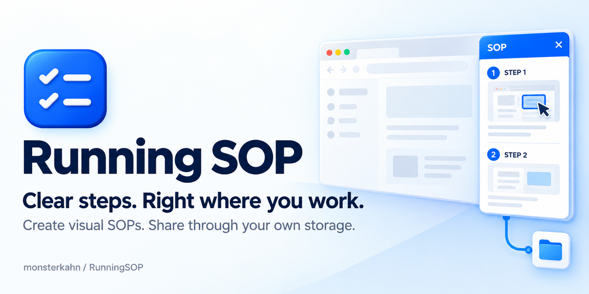

<p align="center">
  
</p>

<h1 align="center">Running SOP</h1>



**Release: v1.3.3** · [Download](https://github.com/monsterkahn/RunningSOP/releases/latest)

Create step-by-step guides with screenshots, follow them beside your work, and share SOPs through a folder you choose.

Version **1.3.3** adds retained-version reading and an SOP overview, clearer screenshot editing, and a safer publication flow. Cleared steps are skipped and the remaining steps are numbered consecutively; an entirely empty SOP cannot be published. Verified publication removes the corresponding unchanged local draft and opens the published steps directly. Other drafts, failed or uncertain writes, and newer concurrent edits are preserved. The previous v1.2.0 release assets remain available. This GitHub release does not submit or replace a Chrome Web Store package. See [Version history](docs/VERSION-HISTORY.md) and [Release review](docs/RELEASE-REVIEW-1.3.3.md).

## What it does

- Recommends SOPs using the current work address. Folder mode matches locally; team mode sends a sanitized work URL to the configured team service. Neither mode inspects form values or arbitrary page text.
- Shows numbered steps, screenshot thumbnails, reporting requirements, approval points and exception-handling branches in a compact side panel.
- Records selected page interactions without reading typed field values. Add your own instructions and capture a single screenshot when you choose.
- Adds numbered markers, arrows and boxes to screenshots. Enlarge images within the current work page when supported, with a safe side-panel fallback.
- Saves local drafts and publishes procedures to a local or mounted shared folder. When the 10-draft limit is reached, confirmed cleanup removes only the selected local draft, not published SOPs.
- Keeps categories separate from SOP content and provides a standalone storage dashboard with available view and feedback statistics.

Folder storage remains the default. An optional experimental team service and library adds shared editing coordination, revision history, and backup/recovery tools. It requires Node.js 24 or later and a separately configured service; it is not enabled by a fresh extension install. Team ratings remain local and team statistics are not included. The service currently uses unencrypted HTTP unless an administrator configures an HTTPS reverse proxy; this project's HTTPS deployment and real two-device/native-permission acceptance have not been verified. See [team service operations](server/README.md) before evaluating it.

SOP guidance does not verify that a business task has been completed, replace organizational checks, or grant an actual approval.

## Install and update

Requires **desktop Chrome 116 or later**. Download the installation ZIP from [GitHub Releases](https://github.com/monsterkahn/RunningSOP/releases/latest).

1. Extract the ZIP to a folder you will keep.
2. Open `chrome://extensions` and enable **Developer mode**.
3. Choose **Load unpacked** and select the extracted `extension/` folder.
4. Pin Running SOP if desired, then click its toolbar icon to open the side panel.

To update, replace the files in the same extension directory and reload it. Do not uninstall first if you need to retain local drafts. GitHub installation and Chrome Web Store review are separate processes. See [Installation](docs/INSTALL.md) for permissions and first-use details.

## Choose your SOP storage

Open **Settings → SOP storage address**, then click the light-blue folder card. Choose a local folder or a shared folder already mounted by your operating system. If it contains no catalog, Running SOP requests write access before creating an empty `catalog.json`; an invalid existing catalog is not replaced.

Reading and publishing use the selected library. Folder access is browser-local and may require reauthorization after a restart. Display names and folder, network-drive or computer icons are local preferences; they do not rename the real folder, log in to a server, or mount a network share.

A light breathing ring guides folder selection or permission recovery. It stops after three cycles or once connected, pauses on hidden pages, and respects reduced-motion preferences. Connection status reflects the most recent read check, not continuous availability or write permission.

New installations have no shared endpoint and do not enable background synchronization. Selecting a library performs one check. Updates preserve previously enabled background settings; the current settings page does not expose separate statistics or automatic-check controls. See [Storage](docs/STORAGE.md).

## Create a procedure

Open your work page, start recording, name the SOP and edit STEP 1. Step titles are optional. Write the instructions, add screenshots and markers, and specify reporting or approval requirements where needed. **Next step** saves the current step before continuing. Review the result before publishing to storage.

Screenshots and manually entered notes can contain sensitive information. Check them before saving or sharing. After verified publication, the corresponding unchanged draft is removed and the published SOP is shown. Cleared steps are omitted; partially completed steps still require valid instructions. Other unpublished drafts stay in this browser; the current recording interface has no backup-export control. See [Guided recording](docs/GUIDED-RECORDING.md).

## Read a retained version in the local candidate

In Settings, choose **View SOP overview** to browse categories, search and read the current library. It follows the enabled team connection, otherwise your explicitly authorized folder. Open an SOP’s version history and choose a retained version. The reader shows that version’s text, images and annotations, identifies it as historical, and provides a return to latest action. History reading does not grant management, publishing or restore permissions, add approval workflows, or change the current published version. Missing or invalid historical content is reported rather than replaced with current content. Folder history depends on retained publication records, version documents, images and any supported catalog backups; it cannot reconstruct deleted material. See [Version history](docs/VERSION-HISTORY.md).

## Chrome standards statement

Running SOP is developed for [Chrome Manifest V3](https://developer.chrome.com/docs/extensions/develop/migrate/what-is-mv3) and has undergone developer self-review against the [Chrome Web Store Manifest V3 code requirements](https://developer.chrome.com/docs/webstore/program-policies/mv3-requirements):

- Uses Manifest V3 and an event-driven background service worker.
- Ships executable scripts inside the extension package; it does not download and execute remote code. SOPs are treated as data.
- Connects permissions to their user-facing purpose. Work-site HTTP(S) permissions are requested on demand, and users select and authorize storage folders.
- Does not read typed input values during recording. Screenshots are initiated by the user, and workflow data stays locally or in user-selected storage.
- Includes no developer cloud analytics service. Permission reasons, privacy disclosures and local review evidence are documented in this repository.

This is a developer statement about implementation and self-review. It is not Google certification or confirmation of Chrome Web Store approval.

## Languages

The extension interface supports English, Simplified Chinese, Traditional Chinese, Spanish, Russian, Korean and Japanese. It can follow the browser language or use a manual choice; unsupported browser languages fall back to English. Authored SOP text, notes and screenshots are not automatically translated. The standalone dashboard supports six interface languages.

GitHub explanatory documentation and public release notes are maintained in English and use official release numbering.

## Privacy, security and review

- [Privacy](PRIVACY.md): processed data, storage and sharing boundaries.
- [Security](SECURITY.md): trust boundaries and private vulnerability reporting.
- [Release review](docs/RELEASE-REVIEW-1.3.3.md): actual test results and limitations.
- [Chrome Web Store metadata](CHROMEWEBSTORE.md): permissions and disclosure preparation.
- [Release checklist](docs/RELEASE-CHECKLIST.md): build, package and manual acceptance checks.

The v1.3.3 release review records current core, service, browser and package verification. Native operating-system authorization, physical two-device NAS/HTTPS acceptance and team statistics remain user-deferred; automated results do not establish that these checks passed or that Google approved the extension.

## Development

Extension development requires Node.js 20 or later. The optional experimental team service requires Node.js 24 or later.

```sh
npm ci
npm test
npm run build
npx playwright install chromium
npm run test:release-browser
```

For a local synthetic demonstration, run `npm run demo:server` after building and open `http://localhost:8080/demo-work-page.html`. In extension settings, select this repository's `examples/storage/` folder. The generated `dist/dashboard.html` can also be opened independently.

```text
extension/              Chrome Manifest V3 runtime
examples/storage/       Synthetic SOPs and demonstration assets
examples/illustrations/ Synthetic instructional images
tests/                  Core and isolated browser tests
tools/                  Build, dashboard and packaging tools
docs/                   Installation, storage and review documents
dist/                   Generated output; not committed
```

The build produces an installation ZIP, a source ZIP, a Web Store upload ZIP and `SHA256SUMS.txt`. The Web Store ZIP has `manifest.json` at its root; it is not the developer installation ZIP. Synthetic examples contain no real workflows, actual business screenshots, credentials or browser profiles.

See [Contributing](CONTRIBUTING.md) and [AGENTS.md](AGENTS.md). Successful checks on `main` publish a version only if it has not already been published. Published binary assets are preserved; documentation and release descriptions may be corrected separately.

## Author and license

**don Kimxote** · [gwangphug@gmail.com](mailto:gwangphug@gmail.com)

Copyright 2026. Released under the [MIT License](LICENSE).

In Team service settings, choose **Select team service** to add, select, rename, edit or delete saved service addresses. Saving/selecting an address does not connect automatically. Enter your display name and join code, then select **Connect**. Only names and addresses are remembered; join codes and sessions are excluded from the address list.
